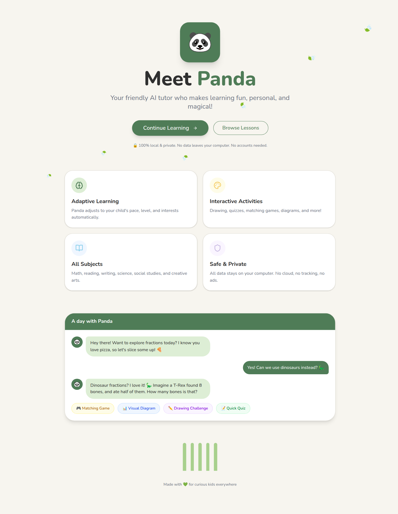
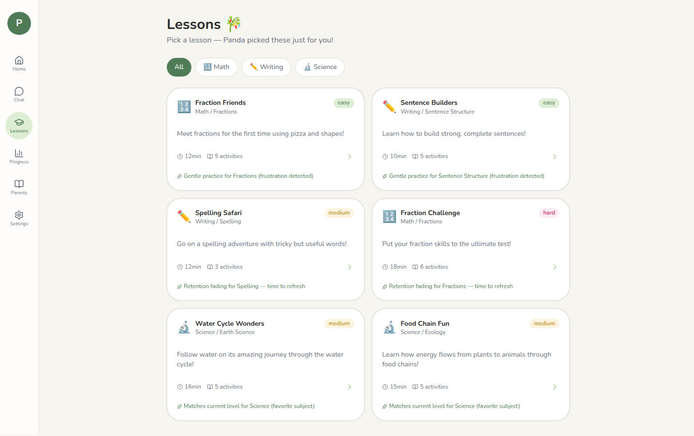
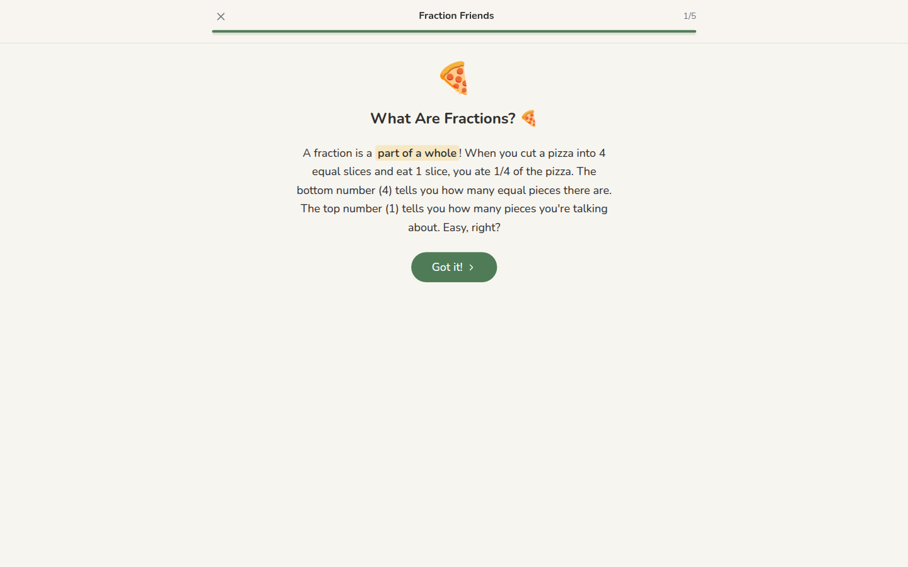
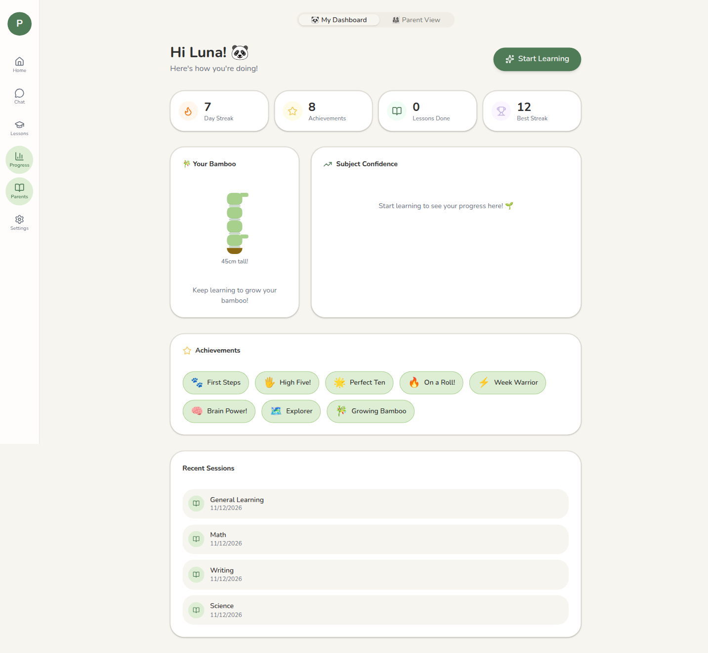
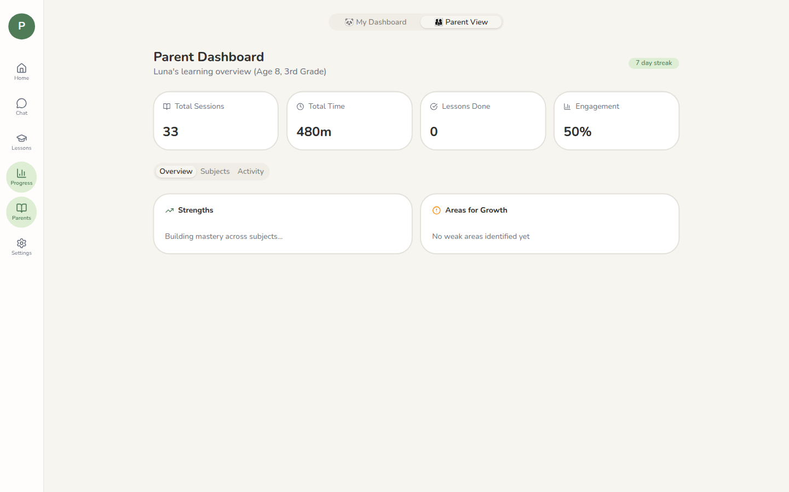

# Panda — Your Friendly AI Tutor

A local adaptive AI tutor for children. Panda teaches through chat, 16 curated lessons, and activities such as matching, quizzes, drawing, and diagrams.

Learning records stay in a SQLite file on this machine. Chat is the exception: each turn sends the conversation and the learner context (including parent notes and learning-support text, when set) to the OpenAI API. That is the only request the app code makes to another service. Nunito is loaded with `next/font/google` and downloaded when Next compiles, then served by the app. Next.js itself may send anonymous telemetry during `dev` and `build` unless `NEXT_TELEMETRY_DISABLED=1`.

There is no public production deploy. This app is meant to run locally.

## Demo

```bash
npm install
cp .env.example .env.local   # set OPENAI_API_KEY
npm run seed                 # optional: demo student (Luna, age 8)
npm run dev
```

Open [http://localhost:3000](http://localhost:3000).

Screenshots below are from a local run after `npm run seed` (demo student Luna, age 8). Chat is not shown: a reply needs `OPENAI_API_KEY`.

**TODO:** record a demo GIF of a live chat turn once an API key is available.











## Features

### For kids

- Tutor prompt calibrated per child for difficulty, vocabulary tolerance, sentence length, format, scaffolding, and hints
- 16 curated lessons in code, four each in math, reading, writing, and science. The lessons screen shows the top 6 recommendations, not the full catalog
- Lesson activities include matching, multiple-choice quizzes, fill-in-the-blank, spelling, drawing, diagrams, sequencing, and labeling, plus reading passages, short answers, writing prompts, and revision
- Examples can use the child's interests when the adaptation decision sets `useInterests`
- Personality rules in `panda-personality.ts` tell the model to celebrate effort and not shame mistakes
- Child dashboard shows the streak, achievements, lessons completed, and bamboo height
- First visit to `/learn` shows a spotlight tutorial. It is stored in `localStorage` under `tutorial-learn`

### For parents

- Parent view at `/dashboard?tab=parent`: session totals, average engagement of recent sessions, and session history
- JSON export and import, and erase-all from Settings after a confirmation step
- Accessibility toggles: dyslexia-friendly spacing (OpenDyslexic if that font is installed, otherwise Comic Sans), larger text, reduced motion, and high contrast. The toggles are saved in `localStorage` (`panda-accessibility`)
- Safety rules in the system prompt: age-appropriate content boundaries and no pressure or shame tactics

### Adaptive brain

Three models in SQLite. `processInteraction()` updates them when the event includes the fields each model needs. Lesson block and lesson completion do that (`subject`, score, time, block type). The chat screen does not send a subject, so a normal chat turn records an event and an adaptation row without changing academic mastery.

- Academic: per-subject and subtopic mastery, confidence, frustration and boredom risk, hint dependence, retention, misconceptions, and format success or failure
- Communication: vocabulary tolerance, sentence length, format preferences, discovery style, and praise style
- Engagement: completion counts, dropout points, time on activity, and per-format scores

`computeAdaptation()` applies six rules, in order, and returns on the first match. The last rule is the default and still sets a hint strategy:

1. Frustration above 0.6 and mastery below 0.5 → simplify and scaffold
2. Mastery at least 0.4 and below 0.7, with confidence below 0.4 → reinforce
3. Mastery at least 0.75 and completion rate at least 0.6 → challenge
4. Boredom above 0.6 → switch format
5. The same misconception on at least two recent mistakes → step-by-step remediation
6. Otherwise keep the current level, and fade hints as hint dependence drops (offer, wait, or withhold)

Each chat turn calls `assembleTutorContext()`, which writes that decision to `adaptation_log` with difficulty and format reasons. Read it with `GET /api/brain?profileId=...` (`view=diagnostics` by default, or `view=adaptation-history`). Lesson selection uses the academic model too, and those lesson-engine choices are not written to `adaptation_log`.

## Stack

| Layer | Technology |
| --- | --- |
| App | Next.js 16.2 (App Router), TypeScript, React 19 |
| UI | Tailwind CSS v4, shadcn/ui, Framer Motion |
| Data | SQLite via `better-sqlite3` (file and schema created on first database open) |
| AI | OpenAI SDK, model `gpt-4o-mini`, streamed as server-sent events |
| Runtime | Node.js 20.9+ (`next` declares `engines.node: >=20.9.0`) |

## Architecture

```
src/
  app/            Landing, onboarding, learn, lessons, dashboard, settings
  app/api/        chat, profile, sessions, progress, lessons, interaction, brain, data
  components/     Panda UI, chat, onboarding, lesson player, dashboards, tutorial overlay
  db/             13-table schema + queries
  lib/            learner-brain, personality, lesson engine and packs, local storage
scripts/          seed, brain-evolution test, personalization checks, prompt dump
data/             panda.db, uploads, and exports (local; gitignored)
```

The 13 tables are `profiles`, `learner_model`, `academic_model`, `communication_model`, `engagement_model`, `sessions`, `messages`, `interaction_events`, `adaptation_log`, `achievements`, `streaks`, `lesson_progress`, and `accessibility_settings`.

**Chat data flow:** load the three learner models into a tutor context and log the adaptation, build the system prompt from `panda-personality.ts` plus that context, record the user message with `processInteraction()`, and stream `gpt-4o-mini`. A second `processInteraction()` runs only when the request or the session has a subject, and it marks that exchange correct. `checkForAchievements()` runs after the reply. `/learn` creates a session with no subject and the chat form does not send one, so that second update does not run there.

**Design choices in this repo:**

- SQLite on disk instead of a hosted database
- The `openai` package, called directly from the chat route. The Vercel AI SDK is not a dependency
- Personality, safety rules, and response structure live in `panda-personality.ts`
- Lessons are ordered lists of 16 activity block types, rendered by `LessonPlayer`

## How to run

**Requirements:** Node.js 20.9 or newer, and an [OpenAI API key](https://platform.openai.com). Lessons, dashboards, and onboarding run without a key. Chat returns an error until `OPENAI_API_KEY` is set.

```bash
git clone https://github.com/Harry0052/Panda.git
cd Panda
npm install
cp .env.example .env.local
# Add OPENAI_API_KEY=...
npm run dev
```

| Script | What it does |
| --- | --- |
| `npm run dev` | Dev server at localhost:3000 |
| `npm run build` / `npm start` | Production build and server |
| `npm run lint` | ESLint |
| `npm run seed` | Add a demo student, Luna (age 8, 3rd grade), with sample learning data. It does not delete other profiles. The app shows the oldest profile |
| `npm run test:brain` | 44 assertions that the adaptive brain evolves across scripted interactions |

`npm run test:brain` prints the assertion total. It writes a profile named TestKid into the local database.

The only environment variable is `OPENAI_API_KEY`.

## Known limits

- No speech input or text-to-speech. `PandaSpeechBubble` is a text component.
- No image generation. Diagrams are drawn as SVG.
- No profile picker. `GET /api/profile` without an id returns the first profile.
- Lesson packs are a static array in `lesson-packs.ts`. The engine can insert hint blocks. It does not generate new lessons.
- Drawing completion always scores the block as correct. The canvas does not look at what was drawn. `expectedConcepts` on the drawing block is unused by the player.
- `StepByStep` and `DiagramLabeler` are not what the lesson player renders. Sequencing uses the `sequence` block. Labeling uses an inline `label_parts` renderer.
- Dashboard subject bars and parent strength or growth badges read `learner_model`. Chat and lessons update `academic_model` instead. `updateMasteryAfterResponse()`, which would write `learner_model` and grow bamboo, is never called. The seed script sets bamboo height with SQL. Achievements and streaks do update: starting a session updates the streak, and chat calls `checkForAchievements()`.
- Onboarding stores pace, attention span, and a teaching-style preference. Lesson ranking uses attention span. The live chat prompt does not read pace or that teaching-style field. `adaptive-engine.ts` still has a pace mapping, and the chat route does not call it.
- Vocabulary tolerance in the prompt changes only when an interaction includes `vocabulary_confusion` or `used_complex_vocabulary`. The chat and lesson routes do not send those signals.
- The accessibility table is created with a profile and included in JSON export. The Settings toggles do not write that table.
- One machine. Export and import are the transfer path. There is no sync.
- Settings can clear a `tutorial-dashboard` flag, and no dashboard page reads it.

## Suggested repo metadata

- **Description:** Local adaptive AI tutor for kids. Next.js, SQLite, and OpenAI, with lessons, matching, drawing, and quizzes.
- **Website:** leave empty until there is a public demo (this app is local by design)
- **Topics:** `nextjs` `typescript` `openai` `sqlite` `education` `ai-tutor` `local-first`
